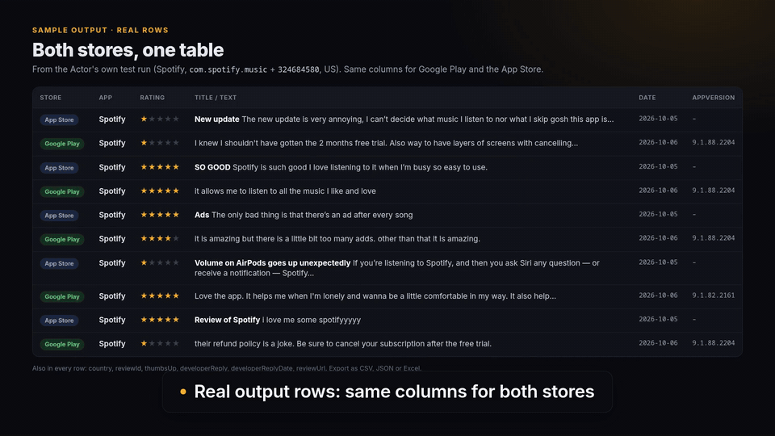
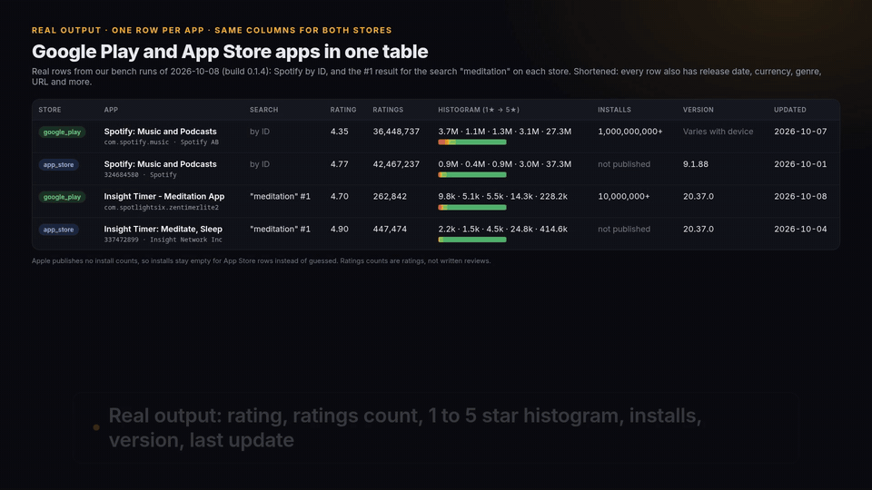

# App reviews from Google Play and the App Store in one CSV

Runnable Python and Node.js examples for [App Reviews Scraper: Google Play & App Store Reviews](https://apify.com/hiver/app-reviews-scraper?utm_source=github&utm_campaign=app-reviews-scraper), an Apify Actor built by hiver.

You give it apps from either store, mixed in one list: Google Play package names or URLs (`com.spotify.music`) and App Store IDs or URLs (`324684580`). You get one row per review with the same columns for both stores: store, app, country, rating, title, text, date, app version, helpful votes, developer reply and its date, review URL.

```
store,appId,appName,country,rating,title,text,date,appVersion,...
google,com.spotify.music,Spotify: Music and Podcasts,us,3,,"not sure why the podcasts queue will only play newest to oldest...",2026-10-06T21:44:38Z,9.1.86.2432,...
```



[Watch the 1-minute walkthrough (MP4, 1080p)](media/example-app-reviews/walkthrough.mp4)

## Run it

You need an Apify account (the free plan includes $5 of usage a month) and its API token from Apify Console > Settings > API & Integrations.

Python 3.11+:

```bash
cd python
pip install -r requirements.txt
export APIFY_TOKEN=your_token
python reviews_to_csv.py com.spotify.music 324684580 --ratings 1 2 --since 2026-10-01
```

Node.js 18+:

```bash
cd node
npm install
export APIFY_TOKEN=your_token
node reviews-to-csv.mjs com.spotify.music 324684580 --ratings 1,2 --since 2026-10-01
```

Both write `reviews.csv`. Options: `--countries us gb de` (each app is fetched once per country), `--ratings 1 2` (complaints only), `--since YYYY-MM-DD`, `--max` (reviews per app and country, up to 5,000), `--max-charge` (the run stops once it has cost this many dollars; default $1.00).

No code: open the [Actor page](https://apify.com/hiver/app-reviews-scraper?utm_source=github&utm_campaign=app-reviews-scraper), paste the apps and download CSV, Excel or JSON.

## Coming from app-store-scraper?

If `app-store-scraper` stopped returning App Store reviews for you, you are not alone. In our check on 2026-10-12 (Python 3.13, one server), the PyPI package (0.3.5, last release 2020, repository archived) returned 0 reviews on 4 of 4 calls: it looks for an access token on the App Store web page that is no longer there, and Apple's review endpoint answers 401. The npm package of the same name (0.18.0) reads Apple's review RSS feed, which came back empty on 27 of 31 first-page calls. The Actor pages through Apple's public web review endpoint without an Apple token.

For Python code that already uses `AppStore`, install this repo's `python/requirements.txt`, put `python/app_store_scraper_compat.py` beside your script (or run from `python/`), and set your own `APIFY_TOKEN`. Change one import line; keep your existing constructor and review call:

```python
# Before: from app_store_scraper import AppStore
from app_store_scraper_compat import AppStore
from datetime import datetime

app = AppStore(country="us", app_name="spotify", app_id=324684580)
app.review(how_many=100, after=datetime(2026, 10, 1), sleep=5)
print(app.reviews_count)
print(app.reviews)
```

What differs from PyPI 0.3.5:

- This is a small migration shim, not the original package or a complete replacement. An explicit numeric `app_id` is required; app-name lookup is not supported.
- Each `.review()` call starts one Actor run on your Apify account. The charge cap defaults to $1.00; lower it with `AppStore(..., max_total_charge_usd=0.25)`. Pricing is $0.09 per 1,000 reviews on the free plan, with no start fee.
- `.reviews` contains `date` (naive UTC `datetime`, like the original), `review`, `rating`, `isEdited`, `title`, and `userName`. `userName` is always `None`: the Actor returns no reviewer names. When present, `developerResponse` contains `id` (`None`, not supplied by the Actor), `body`, and `modified` (the Actor's ISO date string, or `None`). Missing developer responses are omitted.
- `after` is inclusive; naive datetimes mean UTC and timezone-aware datetimes are converted to UTC. `how_many` is an upper bound, with a maximum of 5,000 per call; the source's available window and charge cap may return fewer. Omitting `how_many` requests that maximum. `sleep` is accepted and ignored because the Actor handles pacing.
- Calls append to `.reviews` and update `.reviews_count`, as the library does. Repeating a call can append duplicates; this is not incremental monitoring. Run failures and Actor error rows raise exceptions rather than silently returning an empty list.

Offline verification uses all nine App Store rows from the board's 2026-10-12 export (build 0.1.14, run `f3bCowXbulRwTgHvT`); developer-response and failure cases use explicitly synthetic variants. No live Actor calls:

```bash
cd python
PYTHONDONTWRITEBYTECODE=1 python -m unittest discover -s tests -v
```

Prefer CSV? The existing CLI remains: `--max` replaces `how_many`, `--since` replaces `after`, and App Store IDs go in the same list as Google Play packages.

## What it costs

$0.09 per 1,000 reviews on the free plan, the same for both stores (a little less on higher Apify plans), with no start fee per run (since 2026-10-09). Error rows, and reviews already returned in "only new" mode, are free. So $1 buys about 11,000 reviews.

## What we measured

Our test bench (2026-10-07, build 0.1.4) ran this Actor and three other Apify Store review Actors on the same two cases: the 20 newest US reviews of Spotify on the App Store, and the same on Google Play. Answers were checked against the stores' own pages (app name, rating range, app version, date, and a developer reply on Google Play).

| | This Actor | Other Store Actor covering both stores | Two App Store-only Actors |
|---|---|---|---|
| Checks passed | 8 of 8 | 7 of 8 | 3 of 8 each |
| Reviews returned (40 asked) | 40 | 40 | 10 each on the bench's free Apify plan, none for the Google Play app |
| Price per 1,000 reviews | $0.09 (was $0.25 during the bench) | $0.50 | $0.10 |

Two apps on one day is a small sample. Later builds have not been benched again yet. Field completeness was about the same as the other two-store Actor (86% vs 85%), so we do not claim an edge there.

## Monitoring

Turn on `onlyNew` with a `monitorId` in the Actor input and put it on an Apify schedule (hourly or daily). Each run returns only reviews that earlier runs with the same monitor ID did not, and you pay only for those. Apify integrations can send each run's new reviews to Slack, email, Google Sheets or a webhook.

## App details too: ratings, star histogram, installs, version

Reviews tell you what users say; app details tell you how the app stands. [App Store & Google Play Scraper](https://apify.com/hiver/app-store-google-play-scraper?utm_source=github&utm_campaign=app-reviews-scraper), also by hiver, returns one row per app with the same columns for both stores: rating, ratings count, the 1 to 5 star histogram, installs (Google Play only; Apple publishes none), price, version and last update. Search terms work too, and every search hit comes back with full details.



[Watch the 82-second walkthrough (MP4)](media/app-details/walkthrough.mp4)

On our test bench (2026-10-08, build 0.1.4: details for 4 apps and a "meditation" search in each store, checked against the stores' own pages) it matched 10 of 10 facts on Google Play and 10 of 10 on the App Store, and it was the only Actor tested that covers both stores in one run. The three other Store Actors tested were faster, and a low-cost Google Play-only Actor was cheaper. $1.90 per 1,000 apps on the free plan.

## google-play-scraper search() returns appId None?

If you use the Python package `google-play-scraper` (PyPI 1.2.7, about 700,000 downloads last month) and `search("spotify")` gives you the right app with `appId: None` and `url: None`, it is the library, not your code. Google Play now shows the best match for an app name as a large card above the result list, and 1.2.7 does not read the package name from that card (issue #238 on JoMingyu/google-play-scraper). In our check on 2026-10-14 (Python 3.13, US, English) the top result had `appId: None` for 10 of 10 app names we tried (Spotify, WhatsApp, Duolingo, Calm, Notion, Netflix, Uber, Headspace, Todoist, Slack). The two generic keywords we tried, "meditation" and "budget tracker", came back with IDs. The Node.js package of the same name (10.1.3) returned the right IDs for the same names.

**Free fix first.** A contributor's fix is open as PR #239 and not merged, and 1.2.7 (June 2024) is still the latest release. Installing the fork from that PR returned the right package name for all 10 names in the same check:

```bash
pip install "git+https://github.com/mrbuslov/google-play-scraper.git@fix/app-id-is-empty"
```

**If you would rather not run a fork,** `python/play_package_names.py` sends app names to [App Store & Google Play Scraper](https://apify.com/hiver/app-store-google-play-scraper?utm_source=github&utm_campaign=google-play-scraper-appid) and writes a CSV with the package name, title, developer, rating, installs, version and URL of each hit:

```bash
cd python
pip install -r requirements.txt
export APIFY_TOKEN=your_token
python play_package_names.py Spotify WhatsApp Duolingo Calm --top 3
```

The Actor reads the result links Google Play shows, so the card's app keeps its package name. A local run of the Actor's code on 2026-10-14 with those four names returned `com.spotify.music`, `com.whatsapp`, `com.duolingo` and `com.calm.android` as the top hits, 12 rows with full details in 21 seconds. Those rows are the offline test fixture in `python/tests/`. It costs $1.90 per 1,000 apps on the free plan, so 12 apps cost about $0.02; `--max-charge` (default $0.10) caps a run. Add `app_store` to `stores` in the script's input to get the App Store bundle IDs for the same names.

## Import-swap adapter for Python google-play-scraper 1.2.7

For existing `search()` and `app()` calls, there is also a small adapter in `python/google_play_scraper_compat.py`. It uses the listed [app-details Actor](https://apify.com/hiver/app-store-google-play-scraper?utm_source=github&utm_campaign=google-play-scraper-import-swap), not the reviews Actor. The free fork above is still the first option if you only need the upstream parser repaired.

Install in a fresh environment (Python 3.11+), then run from `python/`, or copy `google_play_scraper_compat.py` beside your script:

```bash
python3 -m venv .venv
. .venv/bin/activate
pip install -r python/requirements.txt
cd python
export APIFY_TOKEN=your_token
```

Change only the import; the original positional arguments and defaults remain accepted:

```python
# Before: from google_play_scraper import search, app
from google_play_scraper_compat import search, app

hits = search("Spotify", n_hits=3, lang="en", country="us")
print(hits[0]["appId"])
details = app(hits[0]["appId"], lang="en", country="us")
print(details["ratings"], details["histogram"], details["updated"])
```

Scope and differences (keys compatible, not full metadata compatibility):

- Only `search()` and `app()` are supplied. The original package is not required or imported. Search returns the same 15 keys as 1.2.7 (which does not include `url`); app returns its same 45 keys including `appId` and `url`.
- Observed values map to `appId`, `title`, `developer`, `score`, `genre`, `price`, `free`, `currency`, and `installs`. Details additionally map `ratings`, `version`, `released`, and `url`. `histogram` is ordered one-star through five-star; missing histograms remain `None`. `minInstalls` is derived from the published install floor, not an exact install count. `updated` is epoch seconds, and `lastUpdatedOn` is the UTC calendar date derived from the Actor timestamp, not the original localized label.
- The Actor does not supply descriptions, icons, screenshots, videos, developer contact details, review counts, exact installs, genre IDs, ads/IAP/sale flags, or comments. Unavailable scalars remain `None`, including boolean flags: they are not invented as false. Unavailable `screenshots`, `categories`, and `comments` are empty lists. A missing version remains `None`, not an invented device-dependent version. Code needing those fields is not a drop-in use case.
- Each positive `search()` or `app()` call starts exactly one paid Actor run; no fallback to the old library, no second detail run per search result, no automatic retry of a failed run. `app()` requires an explicit package ID, not a URL or app name. Errors and mismatched results raise rather than appearing as successful empty details. Empty successful searches return `[]`.
- `n_hits <= 0` returns `[]` without a run. Other searches ask for at most 200 first-page hits, sorted by the Actor's source rank, with duplicate IDs omitted. Store availability, first-page size, and your charge cap may return fewer. Search positions can change with country and time; there is no built-in app-name-to-package lookup table.
- Both functions accept optional `token=`, `client=`, and `max_total_charge_usd=` keywords. Otherwise they read your own `APIFY_TOKEN`; the per-call charge cap defaults to $0.10. Pricing is $1.90 per 1,000 apps on the free plan. The example above makes two runs, not one. These are paid cloud calls, unlike the offline tests below.

Verification (2026-10-15, $0 new Apify spend): all 13 unmodified Google Play rows from board-exported runs `TQemqnIoWc1tZM7y5` (three direct apps) and `xXdaThOR8sRIwdnJF` (ten meditation hits) are in `python/tests/fixtures/play_board_exports.json`. Separate current-Actor-code local read-only calls returned the expected top package IDs for Spotify, WhatsApp, Duolingo, Calm, Notion, Netflix, Uber, Headspace, Todoist and Slack (10/10). Those ten real local rows are explicitly labelled in `play_named_apps_local.json`; they are not board/cloud exports or a comparative bench. The adapter replays all of these offline, checking one Actor call per function call. The real Apify SDK also runs against a loopback HTTP fixture with board rows and a synthetic run envelope, so tests cannot spend cloud credit.

```bash
# From python/; no APIFY_TOKEN or live Actor run required
python -B -m unittest discover -s tests -v
# Optional reference key/signature check (the adapter works without this)
pip install google-play-scraper==1.2.7
python -B -m unittest discover -s tests -v
```

## Notes

- Unofficial. Not affiliated with, endorsed by or sponsored by Google or Apple. The Actor reads the public review pages that the stores show without logging in, and returns review content only: no reviewer profiles, photos or IDs.
- The stores show a limited window of reviews per country and language, so `--max` is an upper bound.
- Something wrong or missing? Open an issue on the Actor's Issues tab on Apify, or here.

MIT licensed examples. Built by [hiver](https://apify.com/hiver?utm_source=github&utm_campaign=app-reviews-scraper).
